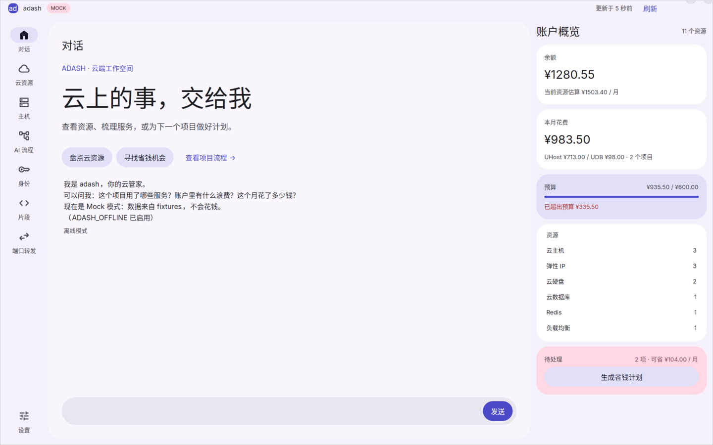

# adash

> 桌面端 UCloud 控制台 + 对话式代理：一句话管云资源、云项目与预算，
> 还能像 n8n 一样看清「这个项目到底用了哪些服务」。

基于 [catussh](https://github.com/mizorewww/catussh) 的外壳骨架，Rust + [GPUI](https://github.com/longbridge/gpui-kit) +
[gpui-kit-material](https://github.com/mizorewww/gpui-kit-material)（Material 3 Expressive）。
代理复用 [pi 的 SDK](https://github.com/earendil-works/pi)，以 `createAgentSession` 嵌入应用
（`agent/runtime`）；所有云操作经 `adash-tool` 的 JSON CLI。

## 三个页面

| 对话（主页） | 云资源 | AI 流程 |
| --- | --- | --- |
| 代理对话 + 账户概览 | 已创建的全部资源 | 项目用了哪些服务、怎么连的 |
| 一句话 → 计划卡片 → 一键确认 → 结果 | 按产品/地域/项目筛选，点进详情 | n8n 风格节点图 + 执行回放 |

导航另有「主机」及身份、片段、端口转发：SSH 传输（终端、SFTP、监控、两种端口转发）
已由独立的 `adash-ssh` 实现，首次连接需核对主机指纹，密码/口令只进系统钥匙串。
主机可编辑并重选身份，终端支持滚动历史、中文 IME、复制粘贴和尺寸同步；SFTP 可编辑文本、
管理目录与文件，并显示可取消的上传/下载进度。多条转发规则可按主机分别运行。

## 界面预览

按 [neko.html](docs/design/neko.html) 的图标导航、圆角面板和色板重做，以下为 Mock 模式下的实际 GPUI 截图。



[云资源](docs/screenshots/resources.png) · [AI 流程](docs/screenshots/flows.png) ·
[1280×800 计划卡片](docs/screenshots/overview-1280.png) · [真实 SSH 终端](docs/screenshots/ssh-terminal.png) ·
[SFTP 文件](docs/screenshots/ssh-files.png) · [截图复现方法](docs/screenshots/README.md)

## 快速开始（Mock，不花钱）

```sh
git clone --recursive <repo>
python3 scripts/build-desktop.py
```

然后在系统启动器搜索 **adash** 即可打开。每次修改后重新运行该命令，构建应用和工具并更新启动入口。
生成文件在 `target/desktop/adash.desktop`，安装到当前用户的应用目录；入口默认使用 Mock 账户，
不会携带截图时的离线或开场提问设置。该开发入口引用当前 checkout 的二进制，移动项目或清理 target 后需重新构建。
直接在终端启动仍可使用 `UDASH_MOCK=1 cargo run -p adash-app`。

构建脚本会安装并编译 `agent/runtime`（SDK 宿主）与 `agent/extensions/ucloud`。
需要本机 `node` 和可用的 SDK 模型配置（可复用正常 pi 配置中的凭据，无需安装 pi CLI）；`adash-tool` 与 app 在同一
`target/debug`，或用 `ADASH_TOOL` 指定。SDK 不可用或模型报错时对话退化为「离线模式」的本地应答
（读同一份数据，不编造，不执行变更）。
Mock 账户里有一台「shop-api」项目（2 台主机 + MySQL + Redis + ULB + EIP + 云盘）、
一个孤儿 EIP 和一块未挂载云盘，`adash-tool reset` 可恢复基线并写入一条可回放的部署记录。

真实账户读取：设置 `UCLOUD_PUBLIC_KEY` / `UCLOUD_PRIVATE_KEY` / `UCLOUD_PROJECT_ID`，
不要设置 `UDASH_MOCK`。UCloud 钥匙串读取及 Live 写操作尚未实现；Mock 计划执行目前记录流程历史，
不会实际创建或删除库存资源。

## 验证

```sh
cargo clippy --workspace --all-targets -- -D warnings
cargo test --workspace
ADASH_SSH_INTEGRATION=1 cargo test -p adash-ssh --test localhost
npm --prefix agent/runtime test
```

SSH 集成测试使用临时密钥与回环 sshd（需要 `sshd`、`ssh-keygen` 和 SFTP server）；
SDK 测试使用回环模型端点与真实 Rust CLI，不调用付费模型或云写接口。
原生窗口可用 `python3 scripts/ssh-smoke.py --capture /tmp/adash-ssh.png` 检查，退出后清理临时服务与数据。

## 文档

从 [AGENTS.md](AGENTS.md)（规则）开始，再看 [docs/](docs/README.md) 的索引。
